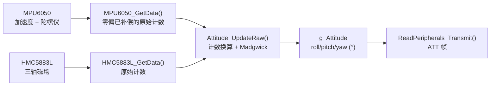

# 四元数姿态解算：Quaternion 与 Madgwick 模块

本文说明本项目新增的四元数数学库和 Madgwick 姿态解算模块：坐标系怎么定、符号为什么这样取、
每个函数的输入输出是什么、在采集任务里怎么接、串口输出的数字怎么读，以及现在还没做什么。

本文只描述当前源码的状态，不代表已经在实机上验证过精度。

## 1. 新增文件与编译

| 文件 | 作用 |
|---|---|
| [MyLib/Quaternion.h](../MyLib/Quaternion.h) | 四元数、三维向量、欧拉角的数据类型与函数声明 |
| [MyLib/Quaternion.c](../MyLib/Quaternion.c) | 纯数学实现，不访问任何硬件 |
| [MyLib/Attitude.h](../MyLib/Attitude.h) | Madgwick 滤波器的接口与可调参数 |
| [MyLib/Attitude.c](../MyLib/Attitude.c) | 目标函数与雅可比矩阵、姿态更新、初始对准、原始计数换算 |

改动到的现有文件：

| 文件 | 改动 |
|---|---|
| [MyLib/ReadPeripherals.h](../MyLib/ReadPeripherals.h) | 新增 `Attitude_Read_t` 与 `g_Attitude` 共享快照 |
| [MyLib/ReadPeripherals.c](../MyLib/ReadPeripherals.c) | 采集任务里调用姿态解算，通信任务里发送 `ATT` 帧 |
| [Config/app_cfg.h](../Config/app_cfg.h) | 通信任务栈从 512 增加到 768 字，给 `%f` 格式化留余量 |
| [LED.uvprojx](../LED.uvprojx) | 在 `MyLib` 分组中登记 4 个新文件 |

`.\MyLib` 本来就在头文件搜索路径里，所以不需要再改 Include Paths。

## 2. 坐标系与符号约定

姿态解算最容易出错的地方不是公式，而是坐标系。本模块的约定如下，后续控制律必须沿用同一套约定。

```text
                    大地系 E（右手系）              机体系 B（右手系）
                         +Z 天                         +Z 上
                          │                             │
                          │                             │
              +Y 西 ──────┼────── +X 北        +Y 左 ──┼── +X 机头
                          │                             │
                        (地面)                        (机身)
```

| 项 | 约定 |
|---|---|
| 机体系 B | 与 MPU6050 芯片轴一致，+X 机头、+Y 左翼、+Z 向上（元件面朝上平放时） |
| 大地系 E | +X 正北、+Y 正西、+Z 天顶，右手系 |
| 四元数 q | 机体 → 大地，`v_E = q ⊗ v_B ⊗ q*` |
| 欧拉角顺序 | ZYX：`R = Rz(-yaw) · Ry(-pitch) · Rx(roll)` |

**为什么 `yaw`、`pitch` 前面是负号？** 教材上的 ZYX 公式默认地理系 Z 轴朝下（NED）。
本项目沿用现有加速度校准的约定：水平静止时 Z 轴读到 `+1g`，也就是 Z 轴必须朝上。
在 Z 轴朝上的右手系里照搬 NED 公式，会得到"低头为正、左转为正"的反直觉结果，
所以这里把这两个角取负，把符号还原成飞行器的习惯：

| 角 | 正方向 | 例子 |
|---|---|---|
| `roll` | 右滚（右翼下沉） | 右滚 10° → `roll = +10°` |
| `pitch` | 抬头 | 抬头 10° → `pitch = +10°` |
| `yaw` | 右转（俯视顺时针），即罗盘航向 | 机头朝东 → `yaw = +90°` |

`yaw` 与罗盘航向同号、同零点（北为 0°），可以直接和手机指南针对照。

## 3. 四元数 API 速查

### 3.1 构造与转换

| 函数 | 说明 |
|---|---|
| `Quaternion_Identity(q)` | 单位四元数 (1,0,0,0) |
| `Quaternion_FromAxisAngle(q, ax, ay, az, angle)` | 绕任意轴旋转；轴不必归一化，长度为 0 时得到单位四元数 |
| `Quaternion_FromEuler(q, roll, pitch, yaw)` | 由本文约定的欧拉角构造，与 `Quaternion_ToEuler()` 互逆 |
| `Quaternion_FromTwoVectors(q, from, to)` | 把 `from` 方向转到 `to` 方向的最短旋转 |
| `Quaternion_FromRotationMatrix(q, m)` | 由行主序 3×3 矩阵构造（Shepperd 分支法，数值稳定） |
| `Quaternion_ToEuler(q, euler)` | 输出 roll/pitch/yaw（弧度） |
| `Quaternion_ToRotationMatrix(q, m)` | 输出行主序 3×3 矩阵，`v_E = R · v_B` |

### 3.2 运算

| 函数 | 说明 |
|---|---|
| `Quaternion_Multiply(out, a, b)` | `out = a ⊗ b`；允许 `out` 与 `a`/`b` 是同一个对象 |
| `Quaternion_Conjugate(out, q)` | 共轭，单位四元数下等价于逆旋转 |
| `Quaternion_Inverse(out, q)` | 逆四元数，非单位四元数也成立 |
| `Quaternion_Norm(q)` / `Quaternion_Normalize(q)` | 模长 / 归一化；归一化失败返回 0 且不修改入参 |
| `Quaternion_Dot(a, b)` / `Quaternion_AngleBetween(a, b)` | 点积 / 两个姿态的最短夹角 |
| `Quaternion_Slerp(out, a, b, t)` | 球面线性插值，自动走最短路径 |

### 3.3 旋转与积分

| 函数 | 说明 |
|---|---|
| `Quaternion_RotateVector(out, q, v)` | 机体系 → 大地系 |
| `Quaternion_RotateVectorInverse(out, q, v)` | 大地系 → 机体系 |
| `Quaternion_Derivative(qdot, q, wx, wy, wz)` | `qdot = ½·q ⊗ (0, ω)` |
| `Quaternion_IntegrateBodyRate(q, wx, wy, wz, dt)` | `q ← q ⊗ exp(½·ω·dt)`，随后归一化 |

`Quaternion_IntegrateBodyRate()` 用的是"采样周期内角速度恒定"的精确解，
而不是 `q += qdot·dt` 的一阶欧拉积分，因此采样周期变化或机体快速转动时都不会明显丢模长。

## 4. 欧拉角与初始对准

### 4.1 由四元数取角

记旋转矩阵元素为 `R[i][j]`（第 i 行第 j 列）：

```text
roll  = atan2(R21, R22)
pitch = asin(R20)
yaw   = atan2(-R10, R00)
```

`pitch = ±90°` 时 `R21`、`R22`、`R10`、`R00` 同时趋近 0，`roll` 与 `yaw` 退化成一个自由度，
这就是欧拉角的万向节死锁。四元数本身没有这个问题，需要做全姿态控制时请直接用 `q`。

### 4.2 用加速度计对准水平

静止时加速度计测到的是重力的反作用力，机体系下应为 `a ≈ (0, 0, 1) g`：

```text
roll  = atan2(a_y, a_z)
pitch = atan2(a_x, sqrt(a_y² + a_z²))
```

### 4.3 用磁力计对准航向

先把磁场按已对准的横滚、俯仰转到大地系（偏航取 0），再取水平分量的方位角：

```text
h   = R(roll, pitch, 0) · m_B
yaw = atan2(h_y, h_x)
```

`h_y` 和 `h_x` 都接近 0（磁场几乎竖直，例如高纬度地区或磁力计贴着重物）时航向没有意义，
代码里会跳过这一步，`mag_valid` 保持 0。

## 5. Madgwick 滤波

### 5.1 目标函数

把"按当前姿态推算出的方向"与"实测方向"之差写成 6 个残差（只有加速度计时是 3 个）：

```text
f(q) = [ v(q) - â ;  w(q) - m̂ ]

v(q) = R(q)ᵀ · (0, 0, 1)              重力方向（机体系）
h    = R(q)  · m̂                      观测磁场转到大地系
b    = ( |h_xy|, 0, h_z )             把水平分量归到大地系 X 轴（磁北）
w(q) = R(q)ᵀ · b                      参考磁场在机体系下的投影
```

两个残差同时为零，说明当前姿态既符合重力方向，也符合磁场方向。
`R(q)ᵀ` 表示转置（即逆旋转）。

### 5.2 更新步骤

```text
J  = ∂f/∂q                            3×4 或 6×4 的雅可比矩阵
∇f = Jᵀ · f                           4 维梯度
q̇  = ½ · q ⊗ (0, ω) - β · ∇f / |∇f|
q  ← q + q̇ · dt
q  ← q / |q|                          归一化
```

- `½·q ⊗ (0, ω)` 是纯陀螺积分项；
- `β·∇f/|∇f|` 是梯度修正项：方向沿残差下降最快的方向，模长固定为 β；
- 残差已经为零（`|∇f|` 接近 0）时不施加修正，避免 0/0；
- 每一步都归一化，所以一阶积分带来的模长误差不会累积。

雅可比矩阵是手写的解析式，见 [Attitude.c](../MyLib/Attitude.c) 里的
`Attitude_GravityTerms()` 与 `Attitude_MagTerms()`。磁场项求导时把参考向量 `b` 视为常量，
这与 Madgwick 原文的处理一致。

### 5.3 参数

| 宏 | 默认值 | 作用 |
|---|---|---|
| `ATTITUDE_BETA_DEFAULT` | 0.10 | β 增益 (rad/s)，观测残差的收敛速率；0 表示只做陀螺积分 |
| `ATTITUDE_DT_MAX` | 0.050 s | 单步 dt 上限，防止任务被长时间抢占后一步转过量 |
| `ATTITUDE_DT_MIN` | 0.0005 s | 单步 dt 下限 |
| `ATTITUDE_ACCEL_MIN_G` / `MAX_G` | 0.30 / 3.00 | 只在该加速度模长范围内采信加速度计 |
| `ATTITUDE_MAG_MIN_HORIZONTAL` | 0.01 | 磁场水平分量（归一化后）过小时不用它修正航向 |

β 按 Madgwick 原文的建议取 `β = √(3/4)·ω_β`，其中 `ω_β` 是陀螺仪的测量误差 (rad/s)。
上电校准后若残余 5°/s（0.087 rad/s），β 约 0.075；本项目默认 0.10。

需要强调：Madgwick 没有积分项，**不估计陀螺零偏**。残余零偏靠 β 与观测项抗衡，
表现为一个固定的小倾角偏差，而不是随时间增长的漂移。

另外，梯度被归一化后每一步的修正量恒为 `β·dt`，所以姿态会在真值附近有一个幅度同样为
`β·dt` 量级的来回抖动（10ms 周期、β=0.1 时约 0.06°），这远小于 MPU6050 的噪声，可以忽略。

### 5.5 主机端数值验证

用 gcc 把 [Quaternion.c](../MyLib/Quaternion.c) 与 [Attitude.c](../MyLib/Attitude.c) 编到 PC 上跑过一组检查：

| 检查 | 结果 |
|---|---|
| 解析雅可比 vs 数值梯度（6 组姿态，含六轴/九轴） | 方向一致，点积 −1.0000 |
| 六轴：静止 20° 俯仰收敛 | 20.000° |
| 九轴：从单位姿态收敛到 (10°, −5°, 40°) | 误差 0.15° 以内（2ms 周期降到 0.01°） |
| 九轴：从 (60°, −40°, 120°) 的初始误差收敛 | 三个角误差均小于 0.02° |
| 四元数模长（长时间运行） | 1.000000 |
| 16 LSB 陀螺仪 1 秒积分 | 0.976°/s（16/16.4） |
| 磁场几乎竖直 / dt ≤ 0 / β = 0 | 分别被拒绝、拒绝、退化为纯积分 |

这些是主机端算法验证，不是实机精度结论。

### 5.4 现象与调整

| 现象 | 可能原因 | 调整 |
|---|---|---|
| 静止时倾角有固定偏差 | 残余陀螺零偏只能靠 β 抵消 | 增大 β（会放大噪声），或改进上电静止校准 |
| 静止时角度持续小幅抖动 | β 太大，振动被当成倾角误差 | 减小 β；改善减震；检查 DLPF 配置 |
| 电机转起来后航向乱跳 | 磁力计受电流干扰 | 先做电源线与磁力计的物理隔离，再考虑校准 |
| 快速转动时角度跟不上 | β 太小 | 增大 β，或提高更新频率 |
| 航向缓慢漂移 | 六轴模式，或磁场观测被门限挡掉 | 确认 HMC 应答、轴向映射和磁场强度 |

## 6. 接入采集任务



### 6.1 时间步长 dt

`ReadPeripherals_Process()` 里用 `HAL_GetTick()` 取两次调用之间的毫秒差：

```c
float dt = (float)(uint32_t)(now_ms - s_attitude_last_ms) * 0.001f;
```

- 任务循环并不是严格的 1ms：每轮还包含二十多次软件 I²C 读写，实际周期通常在 10ms 量级，
  正好和 MPU6050 的 100Hz 输出速率对齐。
- `HAL_GetTick()` 只有 1ms 分辨率，因此 dt 存在 ±1ms 的量化误差；对 10ms 周期约 10%。
  需要更高精度时应改用 `DWT->CYCCNT` 或一个 32 位定时器，而不是假设循环周期等于延时时间。
- 滤波器内部会把 dt 限幅到 `ATTITUDE_DT_MIN..MAX`，所以偶尔的调度抖动不会让姿态跳变。

### 6.2 初始对准

上电后第一次拿到可信样本时调用 `Attitude_InitRaw()`：

- 加速度模长必须在 `0.3g..3g` 之间，否则这一轮不算数，下一轮再试；
- 有磁力计（`g_HmcAddressAck == 0`）时顺便对准航向，没有则航向置 0；
- 此时姿态直接取观测值，不经过滤波，所以**上电时必须静止、水平**，否则初始误差要靠滤波器慢慢收敛。

### 6.3 磁力计是可选输入

`Attitude_UpdateRaw()` 的 `mag` 参数传 `NULL` 就退化成六轴融合，航向只由陀螺积分得到，
会随残余零偏缓慢漂移。当前代码在 HMC5883L 上电无应答时自动这样处理。

模块型号和安装方向会影响磁力计的轴向。`ReadPeripherals_Process()` 里暂时按
"HMC5883L 与 MPU6050 同轴"处理，若实机上发现航向随横滚变化，需要在那一处调整顺序或符号。
另外 HMC5883L 的原始计数在读取失败时会得到全 `0xFF`，代码用 `ATTITUDE_MAG_MIN_LSB`
（100 计数）把这种无效向量挡掉。

### 6.4 内存与栈

`Attitude_t` 约 36 字节，作为 `ReadPeripherals.c` 的静态变量存在，不占任务栈。
通信任务新增了 `%f` 格式化，`APP_CFG_COM_TASK_STK_SIZE` 已从 512 调到 768 字。
重编后的镜像为 `Code=31084`、`RW-data=172`、`ZI-data=14356`，RAM 合计约 14.2KB，
96KB 的 RAM 里余量充足；代码段增加的主要来源是浮点格式化（`_printf_f`），而不是四元数运算。

## 7. 串口输出

在原有的两帧之后，每 5 次通信发送（约 20Hz）追加一帧：

```text
MPU A:0,0,2048 G:0,0,164
HMC M:545,0,0
ATT R:0.12 P:-0.05 Y:90.00
```

| 字段 | 含义 | 单位 |
|---|---|---|
| `R` | `roll`，右滚为正 | ° |
| `P` | `pitch`，抬头为正 | ° |
| `Y` | `yaw`，右转为正，即罗盘航向 | ° |

- `P`、`R` 在水平静止时应接近 0；`Y` 的绝对值取决于当前机头朝向，与当地磁偏角、磁场校准有关。
- 姿态帧按 20Hz 发送而不是 10ms 一帧，是为了不挤占 115200 波特率的带宽：
  `MPU` 帧约 42 字节、`HMC` 帧约 25 字节，每 10ms 两帧已占约 6.7kB/s，再加 20Hz 姿态帧约 7.3kB/s。
- `%f` 需要标准 C 库（工程里 `<useUlib>` 为 0，即未使用 microlib）。
  若以后改用 microlib，需要确认其浮点格式化支持。

## 8. 现在还没做

| 项目 | 状态 | 说明 |
|---|---|---|
| 磁力计硬铁/软铁校准 | 未实现 | 航向会有固定偏差，电机电流也会干扰读数 |
| 磁力计轴向映射 | 未验证 | 代码按同轴处理，需在实机上确认 |
| 加速度计六面校准 | 未实现 | 现有校准只去零偏，不修正比例误差和轴间不正交 |
| 陀螺零偏在线估计 | 未实现 | Madgwick 没有积分项，残余零偏表现为固定的小倾角偏差 |
| 陀螺零偏温度补偿 | 未实现 | 上电校准一次，温度变化后偏差会变大 |
| 振动抑制 | 未实现 | 只靠 DLPF，桨和电机的不平衡仍会进算法 |
| 姿态用于控制 | 未实现 | 目前只解算和上报，控制环还没有接入 |
| dt 高精度时基 | 未实现 | 现在用 1ms 的 `HAL_GetTick()` |
| 单元测试入库 | 未实现 | 验证用的是主机端临时程序（见 5.5），测试代码没有加入工程 |

## 9. 上机验证建议

1. 静态检查：水平静止时 `R`、`P` 应接近 0，晃动后能回到 0 附近。
2. 角度检查：把机体分别倾斜已知角度（例如用直角尺垫 30°），比较 `R`、`P` 的读数。
3. 航向检查：绕 Z 轴转 90°，`Y` 应变化约 90°；转到正北附近把 `Y` 记作 0 再看其他方向。
4. 动态检查：快速摆动后松手，角度不应持续漂移；若收敛过慢或抖动明显，调整 β（见 5.3）。
5. 电机检查：解锁电机后观察 `Y` 是否被电流干扰，必要时做磁力计校准或改变安装位置。

## 10. 代码入口与参考

- [Quaternion.h](../MyLib/Quaternion.h) / [Quaternion.c](../MyLib/Quaternion.c)：四元数数学库。
- [Attitude.h](../MyLib/Attitude.h) / [Attitude.c](../MyLib/Attitude.c)：Madgwick 滤波器。
- [ReadPeripherals.c](../MyLib/ReadPeripherals.c)：采集任务中的调用与串口输出。
- [GY86.h](../MyLib/GY86.h)：量程、1g 计数等传感器参数。

参考：

- S. Madgwick, *An efficient orientation filter for inertial and inertial/magnetic sensor arrays*, 2010。
- S. Madgwick, *Estimation of IMU and MARG orientation using a gradient descent algorithm*, IEEE ICORR, 2011。
- J. Solà, *Quaternion kinematics for the error-state Kalman filter*, 2017（四元数运算与旋转矩阵的推导）。
