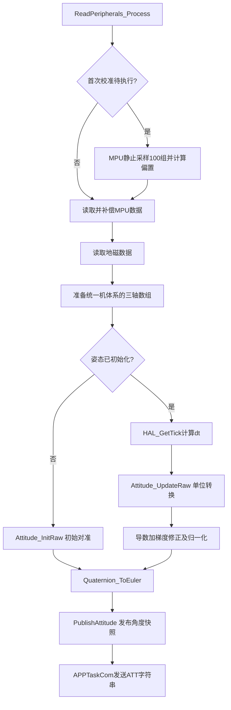

# 从零理解四元数：从三维旋转到项目代码

本文不要求提前掌握四元数。建议按章节顺序阅读：先理解坐标系和向量，再理解四元数乘法，最后看陀螺仪积分与 Madgwick 融合。

本文结合当前 `Quaternion.c/.h`、`Attitude.c/.h` 和 `ReadPeripherals.c` 讲解。示例是数学演示，不会驱动电机，也不代表已经验证了实机姿态精度。

已有 [Attitude_Quaternion.md](Attitude_Quaternion.md) 偏向模块接口与使用；本文侧重从基础推导到实现。

## 1. 我们到底在求什么

飞行器的位置和姿态是两件事：

- 位置：飞行器在哪里。
- 姿态：机头、左翼、机体上方分别朝哪个方向。

姿态可以理解为两个坐标系之间的旋转关系：

| 坐标系 | 特点 | 本项目数学约定 |
|---|---|---|
| 机体系 B | 随机体转动 | X 向前、Y 向左、Z 向上 |
| 大地系 E | 作为参考不随机体转动 | X 北、Y 西、Z 上，即 NWU |

两者都是右手系：`X × Y = Z`。

假设机体系中一个向量是 `v_B`，我们希望求它在大地系的分量 `v_E`：

```text
v_E = R_BE · v_B
```

其中 `R_BE` 是机体到大地的旋转矩阵。四元数是表示同一个旋转的另一种方式。

**坐标约定不等于传感器安装事实。** `Quaternion.h` 假定传感器轴已与机体系对齐，但这需要实物验证。模块“正面朝上”不能直接推出芯片 +Z 朝上。

你曾测到水平静止 AZ 约为 -2011，而当前 ±16g 时 1g 为 2048。这说明原始传感器轴与算法期望可能不一致。接入融合前，应先完成正确的传感器到机体系映射和匹配的零偏校准。

不能仅为让 AZ 变正而随意只反转 Z：单轴镜像的行列式为 -1，不是右手系之间的刚体旋转。例如绕 X 转 180° 的合法映射会同时反转 Y、Z。具体映射必须由安装方向决定，并一致作用于加速度、陀螺仪；磁力计也必须映射到同一机体系。

## 2. 必备数学：向量、点积、叉积

### 2.1 向量

三维向量写成：

```text
v = (vx, vy, vz)
|v| = sqrt(vx² + vy² + vz²)
```

项目类型：

```c
typedef struct {
    float x, y, z;
} Vector3f_t;
```

向量可以表示速度、角速度、磁场，也可以只表示方向。归一化后长度为 1：

```text
v_hat = v / |v|
```

对应 `Vector3f_Length()`、`Vector3f_Normalize()`。零向量没有方向，不能除以零；代码使用 `QUATERNION_EPS` 拦截长度太小的输入。

### 2.2 点积

```text
a · b = ax bx + ay by + az bz
      = |a| |b| cosθ
```

两个单位向量点积为 1 表示同向，为 0 表示垂直，为 -1 表示反向。

对应 `Vector3f_Dot()`。`Quaternion_FromTwoVectors()` 用它判断两个方向是否相同或相反。

### 2.3 叉积

```text
a × b = (
    ay bz - az by,
    az bx - ax bz,
    ax by - ay bx
)
```

它的方向垂直于 a、b，遵循右手定则；长度为 `|a| |b| sinθ`。

对应 `Vector3f_Cross()`。旋转轴、四元数乘法和向量旋转公式都离不开它。

## 3. 为什么不用三个角表示一切

欧拉角用 roll、pitch、yaw 表示姿态，适合人读，但有两个麻烦：

1. 旋转顺序不同，结果不同。
2. ZYX 欧拉角在 pitch = ±90° 时出现表示奇异，roll 与 yaw 不能独立确定。

第二点称为万向节死锁。它不是“飞行器不能转”，而是这组三个角无法稳定、唯一地表达该处的姿态。

旋转矩阵没有这个表示奇异，但需要 9 个数，还要满足列向量正交、长度为 1、行列式为 +1 等约束。

单位四元数用 4 个数和一个模长约束表达旋转，便于复合与积分。它没有欧拉角的万向节死锁，但转回欧拉角后，欧拉角的奇异依然存在。

## 4. 从复数理解四元数

二维复数：

```text
z = a + bi
i² = -1
```

单位复数 `cosθ + i sinθ` 乘到另一个复数上，可以把二维向量旋转 θ。

四元数扩展为：

```text
q = w + xi + yj + zk
```

其中：

```text
i² = j² = k² = -1
ij = k，jk = i，ki = j
ji = -k，kj = -i，ik = -j
```

所以四元数乘法不交换：一般 `a ⊗ b ≠ b ⊗ a`。

也可以写成标量和向量的组合：

```text
q = (w, u)，u = (x, y, z)
```

项目存储顺序是 **w、x、y、z**：

```c
typedef struct {
    float w, x, y, z;
} Quaternion_t;
```

不要与一些库使用的 x、y、z、w 顺序混用。

## 5. 旋转四元数：轴与角度

任意三维刚体旋转都可以表示为：绕某个单位轴 n 旋转 θ。

对应四元数：

```text
q = (cos(θ/2), n sin(θ/2))

w = cos(θ/2)
x = nx sin(θ/2)
y = ny sin(θ/2)
z = nz sin(θ/2)
```

注意：

- θ 是弧度。
- n 必须是单位轴。
- x、y、z 不是三个欧拉角，也不是转轴本身；它们还乘了半角正弦。
- 四元数模长必须为 1。

项目 [Quaternion_FromAxisAngle()](../../MyLib/Quaternion.c) 会先求轴长度，再把 `sinf(half)` 除以轴长度，因此调用者不必提前归一化轴。

核心代码：

```c
half = 0.5f * angle;
s = sinf(half) / norm;
q->w = cosf(half);
q->x = axis_x * s;
q->y = axis_y * s;
q->z = axis_z * s;
```

例如绕 +Z 按右手定则转 90°：

```text
n = (0,0,1)，θ = π/2
q ≈ (0.7071068, 0, 0, 0.7071068)
```

无旋转时：

```text
q = (1,0,0,0)
```

对应 `Quaternion_Identity()`。注意“单位四元数”既可以泛指模长为 1 的四元数，也常被用来特指这个恒等旋转，需要看语境。

## 6. 四元数乘法怎么实现

设：

```text
a = (aw, a_vec)
b = (bw, b_vec)
```

Hamilton 积为：

```text
a ⊗ b = (
    aw bw - a_vec · b_vec,
    aw b_vec + bw a_vec + a_vec × b_vec
)
```

展开：

```text
w = aw bw - ax bx - ay by - az bz
x = aw bx + ax bw + ay bz - az by
y = aw by - ax bz + ay bw + az bx
z = aw bz + ax by - ay bx + az bw
```

这就是 `Quaternion_Multiply()` 中四行计算。它先算到局部 `result` 再赋给 `out`，因此以下原地操作不会破坏尚未使用的输入：

```c
Quaternion_Multiply(&q, &q, &delta);
```

### 6.1 乘法与旋转顺序

采用列向量、主动旋转公式时：

```text
R(a ⊗ b) = R(a) R(b)
```

因此 `a ⊗ b` 对向量的作用是：**先作用 b，再作用 a**。

这是固定轴旋转复合的矩阵解释，不要与“绕当前机体轴施加增量”的叙述混淆；后者将在积分章节解释。

## 7. 共轭、逆与归一化

共轭把向量部分取负：

```text
q* = (w,-x,-y,-z)
```

模长：

```text
|q| = sqrt(w²+x²+y²+z²)
```

逆：

```text
q^-1 = q* / |q|²
```

当 q 是单位四元数时，逆等于共轭。逆旋转可以把向量转回原坐标系。

对应接口：

| 数学操作 | 代码 |
|---|---|
| 共轭 | `Quaternion_Conjugate()` |
| 一般四元数求逆 | `Quaternion_Inverse()` |
| 模长 | `Quaternion_Norm()` |
| 归一化 | `Quaternion_Normalize()` |

数值积分和浮点舍入会使模长偏离 1，因此代码在构造、插值、积分后进行归一化。

归一化只修复模长约束，**不修复错误的坐标系、错误单位或陀螺仪漂移**。模长为 1 不能证明姿态正确。

## 8. 用四元数旋转向量

把向量 v 写成纯四元数 `p=(0,v)`：

```text
p' = q ⊗ p ⊗ q*
```

取结果的向量部分，就是旋转后的 v。当前项目将 q 定义为 B→E：

```text
v_E = q ⊗ (0,v_B) ⊗ q*
v_B = q* ⊗ (0,v_E) ⊗ q
```

为什么是半角？向量左右分别受到 q 和 q* 的作用，展开后得到完整角 θ 的三维旋转。更严格地说，代入轴角式会得到 Rodrigues 公式：

```text
v' = v cosθ + (n × v) sinθ + n(n · v)(1-cosθ)
```

这说明四元数旋转并不是凭空定义的，它与熟悉的轴角旋转一致。

### 8.1 项目的优化实现

对单位 q，展开可写成：

```text
u = (x,y,z)
t = 2(u × v)
v' = v + w t + u × t
```

`Quaternion_RotateVector()` 直接使用两次叉积，不构造纯四元数和做两次完整 Hamilton 积。

```c
Vector3f_Cross(&t, &u, v);
t.x *= 2.0f;
t.y *= 2.0f;
t.z *= 2.0f;
Vector3f_Cross(&c, &u, &t);
out->x = v->x + q->w * t.x + c.x;
```

`Quaternion_RotateVectorInverse()` 先求共轭再调用该函数。

### 8.2 可以手算的例子

```c
Quaternion_t q;
Vector3f_t v = {1.0f, 0.0f, 0.0f};
Vector3f_t rotated;

Quaternion_FromAxisAngle(&q, 0.0f, 0.0f, 1.0f,
                         90.0f * QUATERNION_DEG_TO_RAD);
Quaternion_RotateVector(&rotated, &q, &v);
```

预期 `rotated ≈ (0,1,0)`。在 NWU 系中，这是从北转向西，**不是项目欧拉 yaw 的正 90°**。

项目约定 yaw 为右转正，即北转向东；应调用：

```c
Quaternion_FromEuler(&q, 0.0f, 0.0f,
                     90.0f * QUATERNION_DEG_TO_RAD);
```

此时 q 约为 `(0.7071068,0,0,-0.7071068)`，向前向量旋转后为 `(0,-1,0)`，即东。

## 9. q 与 -q 为什么表示同一姿态

把 q 的四个分量同时取反：

```text
(-q) ⊗ p ⊗ (-q)* = q ⊗ p ⊗ q*
```

两个负号抵消，因此旋转相同。这称为四元数对旋转的双覆盖。

影响：

- 不能按四个分量是否相等判断姿态是否相等。
- 四元数分量整体变号，不一定意味着姿态突变。
- 插值前要选同一半球，避免走长路径。

对单位 a、b，最短姿态差角：

```text
角差 = 2 acos(clamp(|a · b|, 0, 1))
```

对应 `Quaternion_AngleBetween()`，绝对值正是为兼容 q 与 -q。

## 10. 四元数与旋转矩阵、欧拉角

### 10.1 旋转矩阵

单位 q 对应：

```text
R00 = 1-2(y²+z²)   R01 = 2(xy-wz)     R02 = 2(xz+wy)
R10 = 2(xy+wz)     R11 = 1-2(x²+z²)   R12 = 2(yz-wx)
R20 = 2(xz-wy)     R21 = 2(yz+wx)     R22 = 1-2(x²+y²)
```

`Quaternion_ToRotationMatrix()` 按行存入 `m[9]`。矩阵各列是机体系三个单位轴在大地系的表达。

`Quaternion_FromRotationMatrix()` 根据迹和最大对角项分支计算，避免接近 180° 时总用一个公式导致除数很小。输入仍必须是合法旋转矩阵，函数不会替你修复任意畸变矩阵。

### 10.2 本项目欧拉角的特殊符号

当前定义：

```text
R = Rz(-yaw) Ry(-pitch) Rx(roll)
```

| 输出 | 正方向 |
|---|---|
| roll | 右滚，右翼下沉 |
| pitch | 抬头 |
| yaw | 右转，俯视顺时针 |

负号来自项目选定的 NWU 坐标系与角度命名，不是所有 ZYX 四元数公式都必须如此。

`Quaternion_FromEuler()` 构造 qx、qy、qz，再计算：

```c
Quaternion_Multiply(&tmp, &qz, &qy);
Quaternion_Multiply(q, &tmp, &qx);
```

对固定轴列向量的矩阵作用，最右边 Rx 先作用；不要只凭“ZYX”三个字判断实际施加顺序。内禀轴与外禀轴的说法也必须明确。

反解在 `Quaternion_ToEuler()`：

```c
euler->roll  = atan2f(r21, r22);
euler->pitch = asinf(Quaternion_Clampf(r20, -1.0f, 1.0f));
euler->yaw   = atan2f(-r10, r00);
```

`asinf()` 输入限制在 [-1,1]，避免浮点舍入造成定义域错误。输出是弧度；显示角度时再乘 `QUATERNION_RAD_TO_DEG`。

yaw 通常位于 [-180°,180°]，从 +179° 到 -179° 是跨边界，不一定是突然转了 358°。

## 11. 陀螺仪如何推进四元数

陀螺仪给的是角速度，不是角度。输入必须是：

```text
ω_B = (wx,wy,wz)，单位 rad/s
dt：真实两次更新之间的秒数
```

当前 ±2000°/s 的标称灵敏度是 16.4 LSB/(°/s)，因此：

```text
角速度(rad/s) = 补偿后计数 / 16.4 × π/180
```

`Attitude_UpdateRaw()` 已做这一步，不能把原始整数直接传给 `Quaternion_IntegrateBodyRate()`。

### 11.1 增量旋转

假设 dt 内机体系角速度恒定：

```text
θ = |ω_B| dt
n = ω_B / |ω_B|
delta = (cos(θ/2), n sin(θ/2))
q_new = q_old ⊗ delta
```

机体系增量**右乘**；如果角速度表达在大地系，才是相应增量左乘。这源于坐标变换复合：

```text
R_new = R_old · R_delta_body
```

`Quaternion_IntegrateBodyRate()` 实现这一增量，并归一化结果。小角度分支用：

```text
delta.w ≈ 1 - θ²/8
delta.xyz ≈ ω_B dt / 2
```

恒定角速度下，正常轴角分支是精确推进；小角度分支是近似。实际角速度若在 dt 内变化，依然有采样与模型误差。

### 11.2 四元数导数

当 dt 趋近于零：

```text
qdot = 1/2 · q ⊗ (0,ω_B)
```

对应 `Quaternion_Derivative()`：

```c
omega.w = 0.0f;
omega.x = wx;
omega.y = wy;
omega.z = wz;
Quaternion_Multiply(qdot, q, &omega);
```

然后四个分量乘 0.5。导数积分的一阶近似是：

```text
q_new ≈ normalize(q_old + qdot dt)
```

它与增量轴角方法不是同一个实现。当前 Madgwick 更新使用导数加修正的一阶积分，而不是调用 `Quaternion_IntegrateBodyRate()`。

### 11.3 简单示例

```c
Quaternion_t q;
EulerAngles_t e;

Quaternion_Identity(&q);
Quaternion_IntegrateBodyRate(&q, 0.0f, 0.0f,
                            -90.0f * QUATERNION_DEG_TO_RAD, 1.0f);
Quaternion_ToEuler(&q, &e);
```

从单位姿态开始，绕机体 -Z 以 90°/s 转 1 秒，项目定义的 yaw 约为 +90°。

## 12. 为什么只有陀螺仪还不够

零偏、噪声和温度漂移会通过积分累积成姿态误差。例如残余 0.1°/s，60 秒可累积约 6°。

其他传感器提供方向观测：

| 传感器 | 提供什么约束 | 局限 |
|---|---|---|
| 加速度计 | 静止或低动态下的“上”方向 | 运动加速度、振动会污染观测 |
| 磁力计 | 磁场方向，提供航向约束 | 硬铁、软铁和电机电流干扰 |

只知道“上”方向，绕竖直轴转动仍无法区分，因此六轴融合不能消除 yaw 的积分漂移。

磁场必须与“上”方向不平行，才能提供独立的航向信息。磁北也不等于地理真北，未做磁偏角补偿时不要把输出称为精确真北航向。

## 13. Madgwick：把预测方向拉向实测方向

`Quaternion.c` 负责纯数学，`Attitude.c` 负责融合。

### 13.1 重力方向残差

算法的大地系“上”向量为：

```text
up_E = (0,0,1)
```

用当前姿态预测机体系应观测到的方向：

```text
v(q) = R(q)^T up_E
     = (2(xz-wy), 2(yz+wx), 1-2x²-2y²)
f_a(q) = v(q) - a_hat
```

`Attitude_GravityTerms()` 调用 `Quaternion_RotateVectorInverse()` 得到 v，并构造三维残差。

这里的 a_hat 是归一化加速度计比力方向，不是把物理重力向量直接当成 +Z；静止时算法要求比力朝上。

### 13.2 雅可比与梯度

设目标函数：

```text
E(q) = 1/2 · f(q)^T f(q)
```

雅可比 J 表示残差对四个四元数分量的偏导：

```text
J[r,c] = ∂f_r / ∂q_c
grad E = J^T f
```

因此重力项 J 是 3×4；同时有磁场项时合并为 6×4。

例如 `f_a.x = 2xz - 2wy - a_hat.x`，对 `(w,x,y,z)` 求导：

```text
(-2y, 2z, -2w, 2x)
```

对应 `Attitude_GravityTerms()` 的 `J[0]..J[3]`。

代码中的：

```c
for (r = 0; r < rows; r++) {
    for (c = 0; c < 4; c++) {
        grad[c] += J[r * 4 + c] * f[r];
    }
}
```

就是 `J^T f`。源码注释中的“∇f”应理解为这个标量目标 E 的梯度，而不是向量残差 f 本身的普通梯度。

这些是标准 Madgwick 的四分量形式，配合更新后归一化使用；不要把只在单位四元数上成立的旋转表达，误认为能脱离约束对任意四元数使用。

### 13.3 磁场残差

`Attitude_MagTerms()`：

```text
h = R(q) m_hat
b = (sqrt(hx²+hy²), 0, hz)
f_m(q) = R(q)^T b - m_hat
```

它把参考磁场的水平分量放在大地 X 轴，对应磁北，求导时把 b 视为固定值。

磁场归一化后只使用方向，所以无需先统一转换成 Gauss；但仍需正确轴映射和磁场校准。统一比例可在归一化时消去，逐轴不同增益与软铁畸变不会自动消失。

### 13.4 融合更新

```text
qdot_corrected = qdot_gyro - beta · grad / |grad|
q_new = normalize(q_old + qdot_corrected dt)
```

项目默认 `beta = 0.10`。beta 越大，方向观测修正通常越强，也更容易受错误观测影响；beta=0 时不做梯度修正。

残差梯度很小时跳过归一化，避免 0/0。

Madgwick 当前实现没有显式估计陀螺仪零偏。**不能保证所有残余零偏都只表现为固定倾角误差**：六轴 yaw 仍可能漂移，九轴能否约束漂移取决于观测有效性、增益和干扰。

## 14. 项目实际调用链



初始化并非默认姿态永远等于零：

1. `Attitude_InitRaw()` 把加速度计数换成 g。
2. `Attitude_TiltFromAccel()` 从比力方向求 roll、pitch。
3. 如果提供磁场，则做倾斜补偿并求初始 yaw。
4. 用 `Quaternion_FromEuler()` 构造初始 q。

因此传入水平静止 `(0,0,-1)g` 会被解释为倒置姿态，而不是算法自动识别“模块正面朝上”。错误的校准基准也可能把真实安装问题掩盖掉。

更新中的 dt 使用 `HAL_GetTick()` 差值转换为秒，而不是假定任务延时等于整个采集周期。

`Attitude_Update()` 会把正 dt 限制在 0.0005～0.050 秒。这个保护会丢弃超出上限的真实时间；它不能恢复长时间未采样的运动，也不等于正确处理任意调度延迟。

通信输出：

```text
ATT R:10.00 P:5.00 Y:90.00
```

是按项目欧拉角约定的度数。每 5 次通信函数调用输出一次，不保证严格 20 Hz，因为每轮还包含阻塞发送和任务抢占。

## 15. 其他接口怎么理解

| 接口 | 数学含义 | 使用前提 |
|---|---|---|
| `Quaternion_FromTwoVectors()` | 把一个方向转到另一个方向的最短旋转 | 单个方向不足以唯一确定全部姿态 |
| `Quaternion_Dot()` | 四维分量点积 | 解释为姿态夹角时需单位四元数 |
| `Quaternion_AngleBetween()` | 两姿态最短角差 | q 与 -q 视为相同 |
| `Quaternion_Slerp()` | 单位四元数球面插值 | 输入单位化，正常用途 t 在 [0,1] |
| `Quaternion_Inverse()` | 一般四元数求逆 | 零四元数不可逆 |

反向向量的最短旋转角是 180°，但转轴不唯一；`FromTwoVectors()` 会选一条稳定的垂直轴。

SLERP 会在点积为负时翻转目标四元数符号，选最短路径；很接近时改用线性插值再归一化。它是姿态插值方法，不是自动完成传感器融合或消除零偏的方法。

## 16. 学习和调试时怎么验证

建议先做纯数学测试，不连接电机：

1. 恒等旋转：任意 v 旋转后不变。
2. 绕 +Z 90°：X 单位向量转到 +Y。
3. 逆旋转：先旋转再逆旋转，恢复原向量。
4. q 与 -q：旋转同一向量结果相同。
5. 单位模长：构造和积分后 `|q|≈1`。
6. 欧拉角往返：避开 pitch=±90°，比较结果时处理 ±π 边界。
7. 纯陀螺仪：验证单位、轴符号和转速积分。
8. 融合静止姿态：验证加速度方向，再逐步启用磁场。

实机进一步确认：

- 传感器到机体系的轴顺序、正负号及右手性。
- 静止校准时加速度模长约 1g，陀螺仪约零。
- 磁力计与 MPU 轴映射一致，磁场没有异常溢出或严重电流干扰。
- 同一组六轴数据读取一致，有效性和时间戳可靠。
- 缺少新磁场样本时，不把重复旧数据误当成更高频独立观测。

当前输入门限只能做粗筛选。例如加速度模长在 0.3～3g 并不证明“只有重力”，磁场模长大于 100 LSB 也不证明“磁场正确”。API 中的 valid 标志表示被采用，不是精度保证。

## 17. 一页总结

```text
四元数是什么：
    q = (w,x,y,z)，单位模长，表示三维旋转。

轴角怎么构造：
    q = (cos(θ/2), n sin(θ/2))。

怎么旋转向量：
    v_E = q (0,v_B) q*。

怎么叠加旋转：
    Hamilton积；不交换，必须明确轴和左右乘。

怎么用陀螺仪更新：
    机体系角速度用右乘增量；
    qdot = 1/2 q (0,ω_B)。

为什么融合：
    陀螺仪短期跟踪快，但积分会漂移；
    加速度和磁场提供方向约束，但也可能受干扰。

项目如何修正：
    预测方向减实测方向 → J^T f → 梯度修正 → 积分 → 归一化。

最容易错什么：
    坐标系、安装映射、乘法顺序、度与弧度、dt、重力方向。
```

## 源码入口

- [Quaternion.h](../../MyLib/Quaternion.h)：数学约定、类型和接口。
- [Quaternion.c](../../MyLib/Quaternion.c)：构造、Hamilton 积、旋转、积分、插值。
- [Attitude.h](../../MyLib/Attitude.h)：融合输入单位、参数和返回标志。
- [Attitude.c](../../MyLib/Attitude.c)：原始计数转换、初始对准、Madgwick 残差与更新。
- [ReadPeripherals.c](../../MyLib/ReadPeripherals.c)：采集、校准触发、姿态发布和通信。

进一步阅读可查 Madgwick 的《An efficient orientation filter for inertial and inertial/magnetic sensor arrays》。阅读其他库前，务必先核对四元数分量顺序、Hamilton/JPL 约定、机体到大地还是反向、NED/NWU/ENU 坐标系；公式长得相似不代表可以直接混用。
