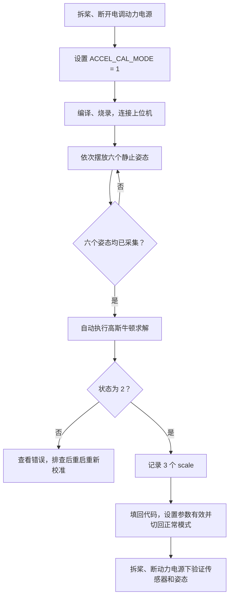

# MPU6050 加速度计六姿态校准操作

本文介绍当前工程中加速度计比例系数的校准与使用方法。校准对象是 **MPU6050 的加速度计**，不是陀螺仪，也不是电调。

> **安全第一：校准前拆除所有螺旋桨，并断开电调的动力电源。** 校准需要翻转整架飞机；即使校准模式跳过了电机初始化和解锁，也不能依赖软件保护代替断电。
>
> 本文依据当前源码编写。该功能尚未进行编译、匿名上位机兼容性或实机验证；不要仅凭文中步骤或一次校准结果就进行飞行。

## 1. 校准什么

MPU6050 的每个加速度轴都可能存在：

- **零偏 bias**：本应输出 0 时，实际输出不为 0，单位为原始计数 LSB。
- **比例误差**：输入变化 1g 时，输出变化的计数与标称值不完全一致。

当前量程为 **±16g**，标称 **1g = 2048 LSB**。模式 1 输出三个 `scale`；模式 0 使用开机静止数据估计零偏，再应用比例系数。X、Y 的补偿公式为：

```text
校准后的原始计数 = (实际原始计数 - 开机零偏) × scale
校准后的加速度(g) = 校准后的原始计数 / 2048
```

静止时，加速度计测量到约 1g 的比力。把传感器摆成不同方向，就能获得多组约束，通过高斯牛顿迭代求出三轴比例系数。求解器内部同时估计零偏，避免零偏干扰比例估计；但该零偏只是中间量，不输出、不保存，也不用于正常运行。**单一的水平静止姿态无法可靠完成六姿态拟合。**

该算法内部拟合各轴零偏和比例，不校正轴间不正交、安装旋转、温漂或磁力计误差。六个姿态是当前自动流程使用的最少集合，求解成功不等于精度已经过独立验证。

## 2. 操作总览



## 3. 校准前准备

1. **拆除四个螺旋桨，断开电调动力电源**，仅以安全的方式给控制板和传感器供电。确保翻转时电源、蓝牙和传感器线不会被拉扯。
2. 将 GY-86 固定牢靠。校准时传感器不能相对于机架晃动；也可以将模块单独固定在能稳定翻转的支架上。
3. 准备平稳的桌面或支架，让每个姿态能静止保持。不要用手悬空拿着采样，手部微动容易中断采样。
4. 确认 MPU6050 的 **X、Y、Z 轴正方向**。这些是芯片坐标轴，不一定等于机头、机身侧面，也不能仅凭模块“正面向上”判断。
5. 准备好接收并记录 ANO 自定义帧的上位机。当前功能尚未验证具体匿名上位机版本是否支持 `0xF1` 帧中的 7 个小端 `float`；先确认能显示这些字段，再采集并记录结果。

之前实测模块平放时原始 `AZ ≈ -2011`，因此这一平放姿态很可能对应下文的 **-Z**，不应因为电路板正面朝上就把它假定成 +Z。

## 4. 选择校准模式

打开 [ReadPeripherals.h](../../MyLib/ReadPeripherals.h)，找到：

```c
#define ACCEL_CAL_MODE 0
```

设置为：

```c
#define ACCEL_CAL_MODE 1
```

编译并烧录到控制板后，程序上电自动进入六姿态校准，无须 Keil Watch 命令。

两种模式的区别：

| 参数 | 作用 |
| --- | --- |
| `ACCEL_CAL_MODE = 0` | 正常启动，运行传感器采集、姿态解算和 ANO 飞控帧发送。 |
| `ACCEL_CAL_MODE = 1` | 跳过开机零偏校准，采集六姿态并发送比例系数；不进入正常姿态采集流程，也跳过电机初始化与最小油门解锁。 |

`ACCEL_CAL_MODE` 是编译期开关：修改后需要重新编译并烧录才会生效。物理断开电调动力电源仍是必要的。

## 5. 上位机连接与通道

当前固件使用 USART1，串口参数为 **115200、8 数据位、无校验、1 停止位（8N1）**。蓝牙配对成功只代表无线连接建立，不等于接收端已经正确解析协议。

校准模式每 40 次通信任务调用发送一帧，通信任务每次发送后延时 5 ms，理论间隔约 200 ms；实际间隔会受发送时间和任务调度影响。

固件调用 `ANO_SendFloats(0xF1, values, 7)`，7 个通道的顺序如下，表中采用**从 1 开始**编号：

| 通道 | 内容 | 说明 |
| --- | --- | --- |
| 1 | `state` | `1` 采集中；`2` 求解成功；`3` 求解失败。 |
| 2 | `mask` | 已完成姿态的位掩码，取值 0～63。 |
| 3 | `sample_count` | 当前姿态已采集的样本数；完成或姿态改变后会清零。 |
| 4 | `error` | `0` 无错误；`1` I²C 读取失败；其他值见第 9 节。 |
| 5 | `scale_x` | X 轴比例系数，无单位。 |
| 6 | `scale_y` | Y 轴比例系数，无单位。 |
| 7 | `scale_z` | Z 轴比例系数，无单位。 |

只有 `state = 2` 时，第 5～7 通道才是本次成功求解的结果。`state = 1` 时这些通道的初值不能当作校准结果。

### 上位机无法直接显示时

不要把二进制帧当成普通文本，也不要把乱码当成计算出的系数。固件实际发送的封包格式为：

```text
AA FF F1 1C | 28 字节数据 | SUM ADD
```

`1C` 是十六进制，表示 28 字节；数据为 7 个 IEEE 754 单精度浮点数，每个 4 字节、**小端序**。从帧首开始，数据偏移分别为 `4、8、12 ... 28`，帧总长 34 字节。`SUM` 是从帧首至最后一个数据字节的逐字节累加低 8 位；`ADD` 是逐次累加各步 `SUM` 的低 8 位。

如果所用匿名上位机不能按此格式映射 `0xF1` 通道，需要使用支持二进制帧解析或保存原始串口数据的工具；具体上位机的映射操作需要以所用版本为准。**当前尚未验证某个上位机版本能够直接显示或保存这些值。**

## 6. 六个姿态怎样摆放

下表的“+X”等指的是**静止时对应加速度原始读数的符号**。理想情况下，加速度计的该正轴指向上方时读数为正；如果模块轴标记、安装方向或接线方向不清楚，以实际采集到的掩码为准。

| 姿态 | 目标 | 对应掩码位 | 十进制位值 |
| --- | --- | --- | --- |
| +X | 静止时 X 轴约 `+2048` | bit 0 | 1 |
| -X | 静止时 X 轴约 `-2048` | bit 1 | 2 |
| +Y | 静止时 Y 轴约 `+2048` | bit 2 | 4 |
| -Y | 静止时 Y 轴约 `-2048` | bit 3 | 8 |
| +Z | 静止时 Z 轴约 `+2048` | bit 4 | 16 |
| -Z | 静止时 Z 轴约 `-2048` | bit 5 | 32 |

摆放方法：

1. 根据传感器轴向，选一个轴，让它尽量垂直于桌面，并将模块稳定固定。
2. 静止等待该姿态的掩码位出现，再换到其他方向；六个姿态**没有固定顺序**。
3. 把同一个轴反向，再依次完成另外两个轴的正反方向。每次翻转时避免触碰电路、短路或拉扯连线。
4. 当 `mask = 63`（即 `0x3F`），说明六个方向都已被接受，程序随后自动求解。

例如先采集到 +X 再采集到 -Z，掩码会从 `1` 变成 `1 + 32 = 33`。已采集过的同一方向不会再加入，所以某次掩码不变化时，先确认该方向是否已经完成。

**不要把 `+Z` 简单等同于“飞机正面朝上”。** GY-86 的安装和芯片坐标决定了正负方向；各姿态应通过轴向和掩码确认。

### 每个姿态要静止多久？

当前实现每个姿态采集 **100 帧**，每帧间隔至少 **10 ms**。理论上至少约 1 秒，考虑任务调度和通信，建议保持更久，并以掩码位出现为准。

如果中途转动或振动，当前姿态的样本计数会清零并重新累积；已经完成的其他姿态仍保留。判断条件包括：

- 主轴原始值绝对值约在 `1536～2560 LSB`，其他两轴绝对值不超过 `1024 LSB`。
- 陀螺仪**原始值**每轴绝对值不大于 `164 LSB`；此处没有扣除开机陀螺仪偏置。
- 加速度各轴在本轮采样中的最大值与最小值之差不超过 `204 LSB`；饱和读数不接受。

这些是代码里的粗略门限，不代表模块已达到某个精度，也不能证明采样一定没有受到振动或外力影响。

## 7. 记录和填回结果

当 `state = 2`，记录通道 5～7 的三个比例系数。结果仅保存在设备内存并重复发送，**断电或复位后丢失**；需要在断电前由上位机记录、截图或保存数据。

打开 [ReadPeripherals.h](../../MyLib/ReadPeripherals.h)，将实际记录值填入：

```c
#define ACCEL_CAL_SCALE_X /* 填入通道 5 */
#define ACCEL_CAL_SCALE_Y /* 填入通道 6 */
#define ACCEL_CAL_SCALE_Z /* 填入通道 7 */
```

上面只是位置示意，**不是可直接编译的定义**。实际填写时，每个宏都必须有浮点常量，例如 `12.34f`、`0.9985f`；请使用自己的实测数值，不要照搬示例。

确认三个数都正确后：

```c
#define ACCEL_CAL_PARAMS_VALID 1
#define ACCEL_CAL_MODE 0
```

`ACCEL_CAL_PARAMS_1G_RAW` 表示校准时的量程灵敏度。当前 ±16g 为 `2048`；更改量程后，不应继续使用旧参数，需在新量程重新采集和校准。启用手填参数时，代码会检查该值与当前量程是否一致。

启用比例系数时，`ACCEL_CAL_START_Z_SIGN` 指定**开机零偏采样时**水平静止的 Z 轴原始读数方向：`-1` 对应负 1g，`1` 对应正 1g。当前默认 `-1`，依据之前约 `-2011` 的实测；必须以实际原始读数确认。X、Y 应水平，Z 应接近所选方向的 1g。

再次编译、烧录。正常模式仍执行开机零偏流程；启用比例系数后，X、Y 扣除开机零偏再乘以系数，Z 使用开机平均值、所选方向和比例系数保留对应方向的 1g。陀螺仪仍使用开机计算的零偏。此单姿态方法不能完整估计三轴零偏和比例，启动时倾斜或晃动会引入误差。

若 `ACCEL_CAL_PARAMS_VALID = 0`，即使宏中写了数字也**不会使用**它们，而是沿用原有开机校准；此路径原有 Z 轴目标是正 1g，`ACCEL_CAL_START_Z_SIGN` 不影响该路径。默认比例 `1` 只是占位值，不代表已完成校准。

## 8. 恢复正常模式后的检查

仍保持拆桨和断开电调动力电源：

1. 正常上电后保持静止，让原有开机零偏采样完成。
2. 检查传感器数据：静止时三轴加速度合成模长应大致接近 1g，转动模块时各轴读数应随方向变化。
3. 检查姿态显示是否随实际姿态变化；不要仅凭模长约等于 1g 判断轴方向正确。
4. 特别确认 **MPU6050 坐标系到机体坐标系的映射**。多姿态校准不会自动调整安装方向；之前平放时 Z 为负，启用真实校准结果后，姿态显示可能与原来不同。
5. 在参数、方向、通信和故障处理经过充分验证前，不要进入飞行测试。

## 9. 常见问题

### 姿态掩码一直不变

- 当前姿态可能已经采集过；换一个尚未完成的方向。
- 模块未放稳、线缆在拉动，或陀螺仪原始零偏过大，可能使当前采样不断清零。
- 轴没有足够接近竖直方向，或加速度值未通过第 6 节的门限。
- `error = 1` 表示原始帧读取失败；检查 MPU6050 供电、接线和 I²C 通信。

### `mask = 63` 但 `state = 3`

六个姿态已收集，但求解失败。通道 4 的错误码按 `AccelCal_Status + 1` 编码：

| 错误码 | 对应含义 |
| --- | --- |
| 2 | 参数无效 |
| 3 | 姿态存储已满 |
| 4 | 姿态数量不足 |
| 5 | 姿态数据退化、覆盖不足或数值条件不合适 |
| 6 | 迭代未收敛 |
| 7 | 拟合残差过大 |

检查摆放是否稳定、是否确实覆盖三轴正负方向、是否发生了通信或传感器异常。当前实现进入失败状态后不会自动重试，需要复位或重新上电，再采集六个姿态。上表列出算法的状态；正常六姿态流程中并非每种错误都必然出现。

### 校准成功后上位机或设备断电了

固件没有自动写入 Flash。设备复位或断电后，本次未记录的结果无法从设备恢复，需要重新校准；已经在上位机保存或抄录的结果不受影响。

### 比例系数是否可以单独填写？

可以。当前模式 1 只输出三个比例系数，求解时的零偏是内部中间量；正常模式的零偏另由每次开机的静止采样决定。单姿态开机校准有方向和水平放置的前提，不能与完整多姿态零偏校准等同。

## 10. 对应源码

- [ReadPeripherals.h](../../MyLib/ReadPeripherals.h)：模式开关、手填参数、ANO 通道说明。
- [ReadPeripherals.c](../../MyLib/ReadPeripherals.c)：姿态识别、静止采样、求解触发和结果发送。
- [AccelCalibration.c](../../MyLib/AccelCalibration.c)：高斯牛顿求解及补偿实现。
- [GY86.c](../../MyLib/GY86.c)：MPU6050 原始数据连续读取。
- [ANO.c](../../MyLib/ANO.c)：浮点数据的小端编码和协议封包。
- [main.c](../../Src/main.c)：校准模式跳过电机初始化与解锁。
