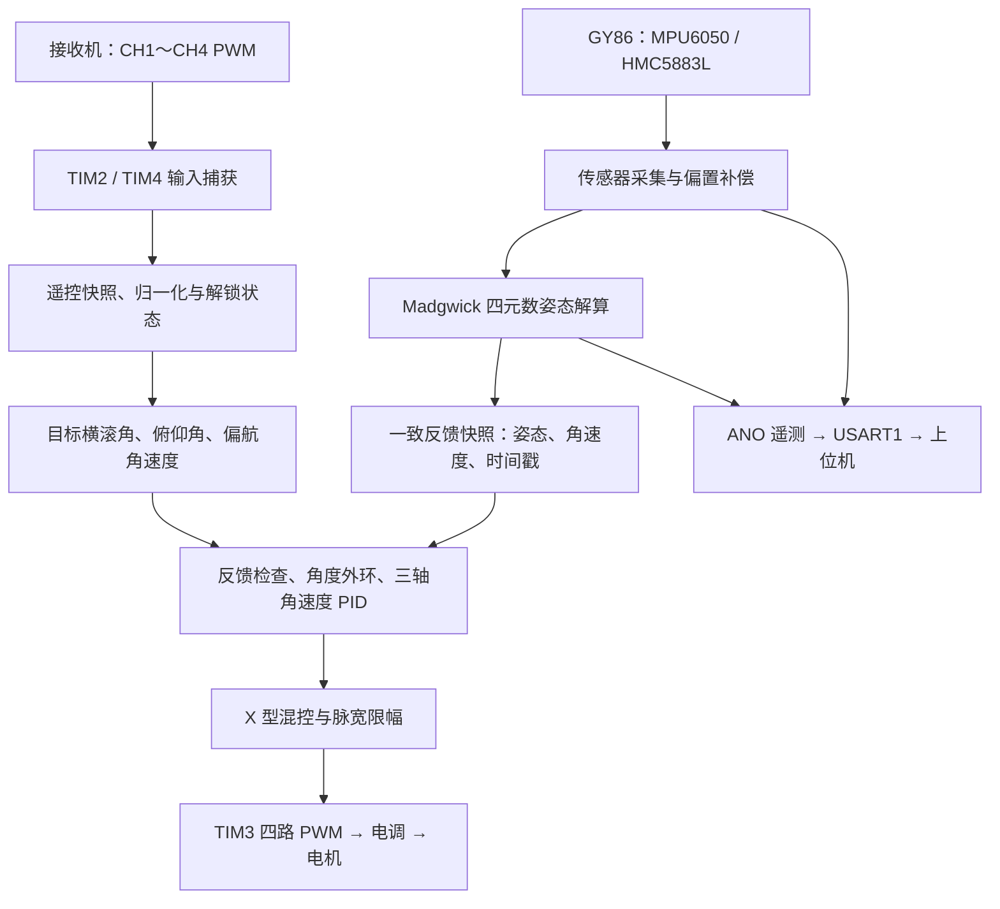

# Quadcopter_2 四旋翼飞控

基于 **STM32F401RE、STM32 HAL 和 uC/OS-II** 的 X 型四旋翼飞控工程。系统采集 GY86 的加速度、角速度和磁场，使用 Madgwick 四元数算法估计姿态，将四路遥控 PWM 转换为控制目标，再通过姿态外环、角速度 PID 和电机混控生成四路电调 PWM。

| 项目 | 当前配置 |
| --- | --- |
| MCU | STM32F401RETx，Cortex-M4，硬件单精度 FPU |
| 系统时钟 | HSI 经 PLL 得到 84 MHz；APB1 为 42 MHz，APB1 定时器时钟为 84 MHz |
| 工程存储配置 | Flash 512 KiB，SRAM 96 KiB |
| 操作系统 | uC/OS-II，抢占式调度，1000 tick/s |
| 构建工具 | Keil MDK；工程指定 ARM Compiler 5.06 update 5（build 528），C99 |
| 工程 / 目标 | `LED.uvprojx` / `Sample` |
| 主要接口 | GPIO 模拟 I2C、四路 PWM 输入捕获、四路电调 PWM、USART1 遥测 |

本文描述当前源码的实际配置。PID 增益为初始调试值，尚需针对实机整定；初次上电和方向检查应拆除全部螺旋桨。

## 导航

- [1. 整体项目架构](#architecture)
- [2. 硬件驱动设计](#drivers)
- [3. 引脚配置与电机布局](#pins)
- [4. 任务与中断优先级](#tasks)
- [5. 姿态解算实现](#attitude)
- [6. 遥控器通道映射](#rc)
- [7. PID 与电机混控实现](#pid)
- [8. 解锁、停机与翻转保护](#protection)
- [9. 遥测与 SystemView](#telemetry)
- [10. 构建、配置与调试入口](#build)
- [11. 当前边界与后续工作](#limits)
- [12. 详细文档](#documents)

<a id="architecture"></a>

## 1. 整体项目架构

### 1.1 分层与数据流



| 层次 | 主要文件 | 职责 |
| --- | --- | --- |
| 应用与调度 | [Src/main.c](Src/main.c)、[Config/app_cfg.h](Config/app_cfg.h) | 初始化、创建任务、组织输入与电机输出 |
| 飞行控制 | [MyLib/FlightControl.c](MyLib/FlightControl.c)、[MyLib/PID.c](MyLib/PID.c) | 保护检查、姿态外环、角速度内环和输出修正 |
| 遥控与混控 | [MyLib/RC_Control.c](MyLib/RC_Control.c) | 脉宽归一化、目标生成、手势、X 型电机分配 |
| 姿态与数学 | [MyLib/Attitude.c](MyLib/Attitude.c)、[MyLib/Quaternion.c](MyLib/Quaternion.c) | 四元数融合、坐标变换与欧拉角换算 |
| 采集与共享数据 | [MyLib/ReadPeripherals.c](MyLib/ReadPeripherals.c) | 校准、采样、解算、发布控制反馈和遥测快照 |
| 硬件驱动 | `GY86`、`MyI2C`、`Receive_IC`、`BLDC`、`UART_Set` | GPIO、I2C、定时器和串口访问 |
| 平台 | `Drivers/`、`Source/`、`Port/`、`ucCPU/`、`ucLib/` | HAL、CMSIS、RTOS 内核与 Cortex-M4 移植 |

控制算法不直接读写 HAL 外设。`FC_Control_Update()` 接收遥控和传感器快照，结果存入 `s_flight_control.rc.motor_us[0..3]`；控制任务统一调用 `BLDC_SetThrottle_us()` 写入四路电调。

### 1.2 目录结构

```text
Quadcopter_2/
├── Src/                     应用入口、中断处理
├── Inc/                     主头文件、HAL 配置
├── Config/                  应用任务配置、uC/OS-II 配置与钩子
├── MyLib/
│   ├── GY86.c/h             MPU6050、HMC5883L、MS5611 驱动
│   ├── MyI2C.c/h            传感器软件 I2C
│   ├── Delay.c/h            TIM5 微秒延时
│   ├── Receive_IC.c/h       遥控 PWM 捕获与输入快照
│   ├── BLDC.c/h             TIM3 电调输出
│   ├── ReadPeripherals.c/h  采样、校准、解算及共享数据
│   ├── Attitude.c/h         Madgwick 姿态融合
│   ├── Quaternion.c/h       四元数与三维向量运算
│   ├── AccelCalibration.c/h 加速度计多姿态校准求解
│   ├── RC_Control.c/h       遥控目标、解锁状态、电机混控
│   ├── RC_Config.h          通道顺序、方向、死区及目标范围
│   ├── PID.c/h              通用 PID
│   ├── FlightControl.c/h    闭环控制及保护状态
│   ├── FlightControlConfig.h PID、滤波及保护参数
│   ├── ANO.c/h              上位机协议组帧
│   ├── UART_Set.h           USART1 初始化
│   └── OLED / BMP180        显示驱动与历史保留代码
├── Drivers/                 STM32 HAL、CMSIS、设备启动文件
├── Source/                  uC/OS-II 内核
├── Port/                    Cortex-M4 上下文切换与 SysTick 移植
├── ucCPU/、ucLib/           Micrium 基础组件
├── SEGGER/                  RTT、SystemView 与 uC/OS-II 跟踪适配
├── PCB/                     PCB 工程、电调接口说明
├── Docs/                    控制、姿态、硬件、通信及调试文档
├── Logs/                    开发记录
└── LED.uvprojx              Keil 工程
```

### 1.3 启动顺序

```text
main
  → HAL_Init / SystemClock_Config
  → OSInit
  → 创建 AppTaskStart
  → OSStart
      → 配置 RTOS SysTick
      → 正常模式初始化 BLDC，再初始化接收机、传感器、USART1
      → 四路保持 1000 μs，等待 5 秒电调上电初始化
      → 创建控制、传感器、通信任务
          → 传感器任务首次运行时采集 100 个偏置校准样本
          → 获得有效姿态后才允许手势解锁
```

偏置校准样本至少间隔 10 ms，正常情况下还需约 1 秒。`ACCEL_CAL_MODE=1` 时跳过电机初始化、5 秒等待和控制任务，进入六姿态加速度校准流程。

<a id="drivers"></a>

## 2. 硬件驱动设计

### 2.1 外设职责与访问方式

| 模块 | 实现方式 | 当前行为 |
| --- | --- | --- |
| 传感器 I2C | PB8/PB9 开漏 GPIO 模拟 | `MyI2C` 实现起停、收发字节及 ACK；边沿延时为 2 μs，实际总线速率受函数和调度开销影响 |
| 微秒延时 | TIM5，1 MHz，32 位自由运行 | 首次使用时初始化，之后通过计数差忙等，不逐次启停定时器 |
| MPU6050 | 14 字节连续读取 | 一次读出加速度、温度字段及陀螺；检查读取事务的 ACK，失败时返回 0 且保持输出参数原值 |
| HMC5883L | 6 字节连续读取 | 寄存器顺序为 X、Z、Y，驱动重排为 X/Y/Z；每 4 次传感器处理调用读取一次 |
| 遥控输入 | TIM2 三通道＋TIM4 一通道 | 在上升沿记录起点、下降沿计算高电平脉宽；中断只采集，不运行 PID、不直接写电机 |
| 电调输出 | TIM3 四路 PWM | 计数频率 1 MHz，周期 20 ms；输出限制在 1000～2000 μs，停止值为 1000 μs |
| 上位机串口 | USART1，115200、8N1 | 使用阻塞 `HAL_UART_Transmit()` 发送二进制遥测；当前未接入 DMA 发送或接收命令解析 |
| MS5611 | 驱动与非阻塞状态机保留 | 当前初始化、采集和气压遥测计算均暂停 |
| OLED | PC2/PC3 独立软件 I2C | 驱动保留，`BSP_Init()` 中的 `OLED_Init()` 调用被注释 |

GY86 使用的 7 位 I2C 地址为 MPU6050 `0x68`、HMC5883L `0x1E`；驱动中的 `0xD0`、`0x3C` 是左移后用于总线传输的地址形式。MS5611 代码配置为 `0x77`，目前未启用。`BMP180.c/h` 为历史保留文件，不是当前气压采集链路。

### 2.2 定时器资源分配

| 资源 | 计数配置 | 用途 |
| --- | --- | --- |
| TIM2 | 84 分频，1 MHz，ARR=`0xFFFFFFFF` | CH1/CH2/CH3 接收机输入捕获 |
| TIM4 | 84 分频，1 MHz，ARR=`0xFFFF` | CH2 接收机输入捕获，按 16 位处理回绕 |
| TIM3 | 84 分频，1 MHz，ARR=`19999` | 四路电调 PWM，50 Hz |
| TIM5 | 84 分频，1 MHz，ARR=`0xFFFFFFFF` | 软件 I2C 所需的微秒延时，无外部输出引脚 |
| DWT CYCCNT | 内核周期计数，84 MHz | 姿态和控制器的实际采样间隔 |
| SysTick | 1000 Hz | HAL 毫秒时间和 RTOS 系统节拍 |

输入捕获会处理计数器回绕、过捕获、异常脉宽，以及长高电平在 TIM4 多次回绕后伪装成正常脉冲的情况。`IC_GetSnapshot()` 短暂屏蔽中断复制输入，并恢复调用前的中断状态。

传感器总线当前集中由传感器任务访问，通信和控制任务使用内存快照。如果增加其他任务直接操作同一 I2C 总线，需要补上总线互斥。

<a id="pins"></a>

## 3. 引脚配置与电机布局

### 3.1 遥控接收机

| 接收机通道 | MCU 引脚 | 复用功能 | 输入数组 | 默认用途 |
| --- | --- | --- | --- | --- |
| CH1 | PA0 | TIM2_CH1 / AF1 | `PWM_IN_Wid[0]` | 横滚 |
| CH2 | PA1 | TIM2_CH2 / AF1 | `PWM_IN_Wid[1]` | 俯仰 |
| CH3 | PB10 | TIM2_CH3 / AF1 | `PWM_IN_Wid[2]` | 自动回中油门 |
| CH4 | PB7 | TIM4_CH2 / AF2 | `PWM_IN_Wid[3]` | 偏航 |
| 信号地 | GND | — | — | 与飞控共地 |

物理引脚在 [Receive_IC.h](MyLib/Receive_IC.h) 配置，通道功能和反向在 [RC_Config.h](MyLib/RC_Config.h) 配置。

### 3.2 电调与机架位置

以 **GY86 +X 正方向为机头**，从飞机上方向下看：

```text
                     机头 / +X
                         ↑
          左前 M3 CW             右前 M2 CCW

          左后 M4 CCW            右后 M1 CW
```

| PCB 槽位，从左到右 | 机体位置 | 程序编号 | MCU 引脚 | 定时器 | 混控旋向要求 |
| --- | --- | --- | --- | --- | --- |
| 最左 | 左后（左下） | M4 | PB1 | TIM3_CH4 / AF2 | CCW，待实测核对 |
| 左二 | 左前（左上） | M3 | PB0 | TIM3_CH3 / AF2 | CW，已确认 |
| 左三 | 右前（右上） | M2 | PA7 | TIM3_CH2 / AF2 | CCW，待实测核对 |
| 最右 | 右后（右下） | M1 | PA6 | TIM3_CH1 / AF2 | CW，待实测核对 |

`motor_us[0..3]` 的顺序始终是 **M1、M2、M3、M4**；`BLDC_SetThrottle_us(pulse, idx)` 使用编号 **1～4**，不按排针的左右顺序编号。PCB 槽位观察方向见 [电机接口引脚说明](PCB/电机接口引脚说明.md)。

CW/CCW 均以俯视为准，要求对角同向、相邻反向。PWM 只改变油门，不改变三相电机旋转方向。电机三相线连接电调输出；PCB 的 `motorV` 是 +5V 网络，不是电机动力电源，电调信号地应与飞控共地。

### 3.3 传感器、串口与显示

| 功能 | MCU 引脚 | 配置 / 状态 |
| --- | --- | --- |
| GY86 SCL | PB8 | GPIO 开漏输出，软件 I2C |
| GY86 SDA | PB9 | GPIO 开漏输出并读取电平，软件 I2C |
| USART1 TX | PA9 | AF7，发送至上位机或串口模块 RX |
| USART1 RX | PA10 | AF7，TX/RX 模式已配置，当前未实现接收命令处理 |
| OLED SCL | PC2 | 独立软件 I2C，当前不初始化 |
| OLED SDA | PC3 | 独立软件 I2C，当前不初始化 |

GY86 总线使用外部上拉，GPIO 配置为 `GPIO_NOPULL`。传感器供电应按实际模块要求接线，并保证与 MCU 的 3.3V 逻辑兼容。

<a id="tasks"></a>

## 4. 任务与中断优先级

### 4.1 应用任务

uC/OS-II 的**优先级数值越小，任务优先级越高**。优先级及栈大小集中在 [Config/app_cfg.h](Config/app_cfg.h)，系统节拍位于 [Config/os_cfg.h](Config/os_cfg.h)。

| 任务 | 优先级 | 栈大小（OS_STK 项） | 字节数 | 循环节奏与职责 |
| --- | --- | --- | --- | --- |
| `AppTaskStart` | 3 | 256 | 1024 | 完成初始化和任务创建后，每 1 秒唤醒一次 |
| `AppTaskControl` | 5 | 512 | 2048 | 读取快照、检查保护、运行闭环、写四路电调，再延时 5 ms |
| `AppTaskSensor` | 6 | 512 | 2048 | 采集、校准与姿态解算，再延时 1 ms；首次运行先完成偏置校准 |
| `APPTaskCom` | 9 | 768 | 3072 | 复制传感器/姿态数据并发送 ANO 遥测，再延时 5 ms |

`OS_STK` 在本移植中为 32 位。调试任务的创建代码未启用；系统保留软件定时器任务优先级 61、统计任务 62、空闲任务 63，业务任务应避免占用这些编号。

这些延时是**执行结束后的相对延时**。实际周期还包含 I2C、计算、串口发送及抢占开销，控制任务并不是严格的 200 Hz；PID 使用实际时间间隔计算。MPU6050 的硬件输出率为 200 Hz，软件发布序号也不等同于芯片数据就绪计数。

### 4.2 中断与临界区

| 中断 / 配置 | 当前优先级 | 作用 |
| --- | --- | --- |
| SysTick | 逻辑优先级 1，由 RTOS 移植层设置 | `HAL_IncTick()`，OS 运行后调用 `OS_CPU_SysTickHandler()` |
| TIM2、TIM4 | 抢占优先级 2，子优先级 0 | HAL 输入捕获；外层使用 `OSIntEnter()` / `OSIntExit()` |
| PendSV | 最低逻辑优先级 15 | 任务上下文切换，由汇编移植层执行 |
| USART1 | 当前未启用串口中断 | 遥测采用阻塞发送；头文件中的中断配置宏没有在初始化中调用 |

任务优先级与 NVIC 中断优先级属于不同的配置体系，不能直接按数值比较。移植使用 `CPU_CFG_KA_IPL_BOUNDARY=1`、`CPU_CFG_NVIC_PRIO_BITS=4`，`OS_ENTER_CRITICAL()` 通过 BASEPRI 保护共享数据。

控制反馈在传感器端组装完整后进入临界区整体发布，控制端再复制快照，防止高优先级控制任务读到写入一半的姿态或陀螺数据。临界区内只复制数据，I2C、浮点解算和串口发送均在临界区外完成。

<a id="attitude"></a>

## 5. 姿态解算实现

### 5.1 采样与单位

MPU6050 初始化配置位于 [GY86.c](MyLib/GY86.c)，物理量换算常量位于 [GY86.h](MyLib/GY86.h)。

| 参数 | 寄存器配置 / 数值 | 用途 |
| --- | --- | --- |
| 陀螺仪量程 | `GYRO_CONFIG=0x18`，±2000°/s | 灵敏度 16.4 LSB/(°/s) |
| 加速度计量程 | `ACCEL_CONFIG=0x18`，±16g | 1g 对应 2048 LSB |
| 采样分频 | `SMPLRT_DIV=0x04` | 当前配置输出率 200 Hz |
| MPU 数字低通 | `CONFIG=0x01` | 当前选择的陀螺带宽约 184 Hz |
| 姿态解算输入 | 陀螺 rad/s、加速度 g | `Attitude_UpdateRaw()` 负责从计数换算 |
| 控制器输入 | 角度 °、角速度 °/s | 与遥控目标和 PID 参数单位保持一致 |

`ReadPeripherals_Process()` 的主要流程为：

```text
开机偏置校准 → 读取 MPU6050 → 偏置补偿 / 可选比例修正
             → 记录 DWT 和毫秒时间戳
             → 按分频读取 HMC5883L
             → 初始化或更新 Madgwick 滤波器
             → 发布姿态与控制反馈快照
```

### 5.2 坐标系与角度约定

机体系采用 **X 向前、Y 向左、Z 向上**；大地系采用北、西、天，均为右手系。四元数 `q=(w,x,y,z)` 表示机体系到大地系的旋转：

```text
v_E = q ⊗ v_B ⊗ q*
R = Rz(-yaw) · Ry(-pitch) · Rx(roll)
```

| 角度 | 正方向 |
| --- | --- |
| roll 横滚 | 右翼下沉、左翼抬起 |
| pitch 俯仰 | 抬头 |
| yaw 偏航 | 俯视顺时针右转；北为 0°、东为 +90° |

四元数数学接口和内部欧拉角使用 rad，发布到控制与遥测的姿态使用 °。姿态模型要求水平静止时补偿后的加速度约为 `(0,0,+1)g`；模块安装方向必须与此坐标约定一致。

### 5.3 Madgwick 四元数融合

[Attitude.c](MyLib/Attitude.c) 使用加速度重力方向、可选磁场方向建立残差，计算梯度修正陀螺积分：

```text
gradient = Jᵀ · residual
q_dot = 0.5 · q ⊗ (0, gx, gy, gz) - beta · gradient / |gradient|
q_next = normalize(q + q_dot · dt)
```

首次有效加速度用于对准横滚和俯仰，磁场可用时同时初始化航向。后续更新中：

1. 将加速度和磁场归一化，构造重力项及可用的磁场项。
2. 通过残差和雅可比矩阵计算四元数梯度；梯度过小时不做归一化修正，避免除零。
3. 陀螺积分与梯度修正共同更新四元数，归一化后换算欧拉角。
4. 没有可用磁场时使用六轴融合；偏航主要依赖陀螺积分，不具备绝对航向观测。

`ATTITUDE_BETA_DEFAULT=0.10`。加速度模长仅在 `0.30g < |a| < 3.00g` 时参与重力修正；磁场还检查向量有效性和水平分量。融合时间间隔按 DWT 周期差换算，并限幅到 0.5～50 ms。`UPDATED`、`ACCEL`、`MAG` 标志分别表示完成更新、使用加速度修正、使用磁场修正。

### 5.4 校准与反馈快照

正常模式每次开机采集 100 个样本估计加速度和陀螺偏置，因此当前启动流程依赖**水平、静止**。该均值流程没有自动验证水平和静止，不应在倾斜或运动中上电校准。

| 配置，位于 `ReadPeripherals.h` | 当前值 | 含义 |
| --- | --- | --- |
| `ACCEL_CAL_MODE` | 0 | 正常采样与控制；设为 1 时进入六姿态采集并跳过电机控制 |
| `ACCEL_CAL_PARAMS_VALID` | 0 | 当前未应用六姿态比例系数 |
| `ACCEL_CAL_PARAMS_1G_RAW` | 2048 | 校准参数对应的加速度计量程 |
| `ACCEL_CAL_SCALE_X/Y/Z` | 1.0 | 比例修正参数，参数有效开关打开后才应用 |
| `ACCEL_CAL_START_Z_SIGN` | -1 | 可选比例修正分支中的启动 Z 方向，启用前须核实安装方向和姿态模型的一致性 |

[AccelCalibration.c](MyLib/AccelCalibration.c) 提供多姿态拟合求解。自动六姿态模式采集 ±X、±Y、±Z 静止样本，输出比例系数供手动记录并填回源码，当前没有 Flash 参数持久化。具体步骤见 [六姿态校准操作](Docs/Hardware/MPU6050_加速度六姿态校准操作.md)。

控制器使用 `FC_Feedback_t`：

| 字段 | 含义 |
| --- | --- |
| `roll_deg`、`pitch_deg` | 同一采样解算的姿态角 |
| `rate_dps[0..2]` | 已统一控制正方向的机体角速度 |
| `timestamp_ms` | 采样毫秒时间，用于过期检查 |
| `timestamp_cycles` | DWT 采样时刻，用于实际 PID 时间间隔 |
| `sequence` | 软件采集、解算完成后的发布序号 |
| `valid` | 本次控制反馈有效标志 |

MPU6050 读取失败或姿态更新返回失败时撤销有效反馈。控制器不使用遥测中的采样计数 `tick` 计算时间；同一个反馈序号也不会被重复积分。

<a id="rc"></a>

## 6. 遥控器通道映射

配置位于 [RC_Config.h](MyLib/RC_Config.h)，实现位于 [RC_Control.c](MyLib/RC_Control.c)。输入控制范围为 1000～2000 μs，中点 1500 μs；捕获层允许 900～2100 μs 的边界容差，解码时再限制到控制范围。

| 通道 | 数组下标配置 | 方向配置 | 脉宽增大时 | 目标范围 |
| --- | --- | --- | --- | --- |
| CH1 横滚 | `RC_ROLL_CHANNEL=0` | `RC_ROLL_DIRECTION=1` | 右滚 | -20°～+20° |
| CH2 俯仰 | `RC_PITCH_CHANNEL=1` | `RC_PITCH_DIRECTION=-1` | 低头、前倾 | -20°～+20° |
| CH3 油门 | `RC_THROTTLE_CHANNEL=2` | `RC_THROTTLE_DIRECTION=1` | 超过中点死区后增加油门 | 0～1 |
| CH4 偏航 | `RC_YAW_CHANNEL=3` | `RC_YAW_DIRECTION=1` | 右转 | -90°/s～+90°/s |

通道配置值是从 0 开始的接收数组下标，四项必须互不相同。方向只能取 `1` 或 `-1`；若实际摇杆运动与脉宽增减关系不同，调整对应方向配置。

### 6.1 横滚、俯仰和偏航

死区为中点两侧各 20 μs。设 `delta = pulse - 1500`，先计算归一化轴量：

```text
|delta| <= 20： axis = 0
|delta| > 20：  axis = sign(delta) * (|delta| - 20) / 480
axis *= direction
```

`RC_MakeSetpoint()` 将轴量转换为目标横滚角、俯仰角及偏航角速度。油门有效时，横滚和俯仰回中对应水平目标；偏航回中对应零转速目标，不要求机头转回 0° 航向。

### 6.2 自动回中油门

CH3 使用单向半程油门，适配自动回中摇杆：

```text
throttle = clamp((pulse - 1520) / 480, 0, 1)
T = 1000 + throttle * 1000
```

| CH3 脉宽 | 归一化油门 | 混控前基础脉宽 |
| --- | --- | --- |
| 1000～1520 μs | 0 | 1000 μs，停止值 |
| 1760 μs | 0.5 | 1500 μs |
| 2000 μs | 1 | 2000 μs |

若油门方向配置为 `-1`，先将脉宽反向，再执行上述规则。**松开油门回中会停机**，系统没有回中自动悬停或高度保持功能；油门为零时，其他三个摇杆也不会使电机转动。

`RC_Control_Update()` 只生成目标和解锁状态，单独调用时电机输出保持停止值。只有 `FC_Control_Update()` 完成保护检查和 PID 计算后，才生成实际混控结果。

<a id="pid"></a>

## 7. PID 与电机混控实现

### 7.1 控制结构与单位

横滚、俯仰采用**角度 P 外环＋角速度 PID 内环**；偏航采用角速度 PID。实现入口为 [FlightControl.c](MyLib/FlightControl.c)，通用 PID 位于 [PID.c](MyLib/PID.c)。

```text
目标角度 - 实测角度 → 角度 P 外环 → 目标欧拉角速度
                                    ↓ 坐标转换
目标机体角速度 - 实测机体角速度 → 三轴 PID → R/P/Y 脉宽修正
```

根据机体系和角度正方向，陀螺反馈转换为：

```text
roll_rate  =  gx / 16.4
pitch_rate = -gy / 16.4
yaw_rate   = -gz / 16.4
```

上述值为机体角速度，单位 °/s；它们在机体倾斜后不直接等于欧拉角变化率。角度外环先得到：

```text
roll_dot  = clamp(Kp_angle_roll  * (roll_target  - roll_measured),  ±120)
pitch_dot = clamp(Kp_angle_pitch * (pitch_target - pitch_measured), ±120)
yaw_dot   = yaw_rate_target
```

再按当前横滚 φ、俯仰 θ 转换目标机体角速度；三角函数使用 rad：

```text
roll_rate_target  = roll_dot - yaw_dot * sin(θ)
pitch_rate_target = pitch_dot * cos(φ) + yaw_dot * sin(φ) * cos(θ)
yaw_rate_target   = -pitch_dot * sin(φ) + yaw_dot * cos(φ) * cos(θ)
```

转换后横滚、俯仰机体角速度目标限制为 ±120°/s，偏航限制为 ±90°/s。

### 7.2 PID 离散实现

对于目标角速度 `r`、滤波实测角速度 `y`、实际时间间隔 `dt`：

```text
error = r - y
P = Kp * error
I_candidate = clamp(I_previous + Ki * error * dt, ±I_limit)
D = -Kd * LPF((y - y_previous) / dt)
output = clamp(P + I + D, ±output_limit)
```

- 陀螺反馈先经过 30 Hz 一阶低通，测量微分再经过 10 Hz 一阶低通；系数按实际 `dt` 更新。
- D 对测量值求微分，避免目标阶跃直接产生微分冲击；第一次更新只初始化微分历史。
- I 项有独立限幅；当积分将使输出饱和更严重时拒绝该次积分，允许反向退饱和。
- 油门低于 0.10 时冻结积分，回中停机、上锁或故障时清空 PID 与滤波历史。
- 混控后根据四路 PWM 反算实现的差速，用 `PID_TrackOutput()` 回算积分；回算针对 PWM 差速，不是电机转速测量。
- 非法输入、时间间隔和非有限数会触发错误返回，由飞控层停机上锁。

第一次有效控制使用 5 ms 初始化步长，后续按消费的反馈样本时间计算：

```c
dt = (float)(uint32_t)(current_cycles - previous_cycles) / SystemCoreClock;
```

先做无符号差分再换算为秒，以处理 DWT 回绕。飞控要求后续 `dt` 在 1～25 ms 内；超出范围会停机，而不是继续积累误差。重复反馈快照保留上次修正量，只重新应用当前油门。

### 7.3 初始参数

集中配置位于 [FlightControlConfig.h](MyLib/FlightControlConfig.h)，修改后重新编译。

| 参数 | 横滚 | 俯仰 | 偏航 | 单位 |
| --- | --- | --- | --- | --- |
| 角度外环 Kp | 4.0 | 4.0 | 无角度外环 | (°/s)/° |
| 角速度 Kp | 0.80 | 0.80 | 1.00 | μs/(°/s) |
| 角速度 Ki | 0.25 | 0.25 | 0.20 | μs/° |
| 角速度 Kd | 0.005 | 0.005 | 0 | μs/(°/s²) |
| I 项限幅 | ±50 | ±50 | ±40 | μs |
| PID 输出限幅 | ±200 | ±200 | ±120 | μs |

积分回算增益为 `5.0/s`。Ki 已在代码中乘 `dt`，Kd 已除 `dt`，参数中不应重复补偿采样周期。上述值是初始调试参数，不是针对本机完成实测整定的参数；调参先处理角速度内环，再调整角度外环。

### 7.4 X 型电机混控

`RC_Mix()` 接收基础油门 T 和 PID 输出 R/P/Y，单位全部为 μs。R 右滚、P 抬头、Y 右转为正；按左前 CW 的配置：

```text
M1 右后 = T - R - P - Y
M2 右前 = T - R + P + Y
M3 左前 = T + R + P - Y
M4 左后 = T + R - P + Y
```

| 正向控制 | 增加输出 | 减少输出 |
| --- | --- | --- |
| 右滚 | 左前 M3、左后 M4 | 右前 M2、右后 M1 |
| 抬头 | 左前 M3、右前 M2 | 左后 M4、右后 M1 |
| 右转 | 右前 M2、左后 M4（CCW） | 左前 M3、右后 M1（CW） |

若修正量总跨度超过可用输出范围，先同比缩小差速，再平移公共油门，使四路保持在 1000～2000 μs 内。因此输出饱和时公共油门可能偏离原始 T。`RC_FRONT_LEFT_CW=0` 用于四台电机旋向全部反转后的偏航符号调整，不能替代实物旋向核对。

<a id="protection"></a>

## 8. 解锁、停机与翻转保护

### 8.1 正常操作

1. 水平静止上电，等待电调初始化及偏置校准完成，确认反馈和四路遥控输入有效。
2. 总倾角不超过 15°，油门回中、横滚/俯仰居中，偏航右满保持 1 秒解锁。
3. 偏航先回中，再增加油门；控制器开始根据目标与反馈产生电机差速。
4. 油门回中立即发送停止值并清空 PID，保留解锁状态。
5. 油门回中、偏航左满保持 1 秒，普通上锁。

### 8.2 保护条件与状态码

所有故障都会停止输出并上锁。除翻转故障外，恢复有效输入后也需要重新执行解锁手势，高油门恢复信号不会直接启动。

| 状态码 | 名称 | 含义 / 触发条件 |
| --- | --- | --- |
| 0 | `FC_STATUS_DISARMED` | 已上锁 |
| 1 | `FC_STATUS_ACTIVE` | 闭环正在运行 |
| 2 | `FC_STATUS_THROTTLE_OFF` | 已解锁，但油门为零，电机停止 |
| 3 | `FC_STATUS_RC_LOST` | 任一路输入无效、脉宽异常或达到 100 ms 未更新 |
| 4 | `FC_STATUS_FEEDBACK_INVALID` | 反馈无效、非有限数、陀螺接近饱和或角速度异常 |
| 5 | `FC_STATUS_FEEDBACK_STALE` | 控制反馈达到 30 ms 未更新 |
| 6 | `FC_STATUS_ARM_TILT` | 解锁时总倾角超过 15° |
| 7 | `FC_STATUS_EXCESS_TILT` | 总倾角达到 70°，或有效反馈下翻转故障仍处于锁存状态 |
| 8 | `FC_STATUS_BAD_TIMING` | 采样间隔不在允许的 1～25 ms 范围内 |
| 9 | `FC_STATUS_PID_ERROR` | PID 输入、配置或计算异常 |

### 8.3 翻转保护与恢复

采用机体向上轴相对大地向上轴的**总倾角**判定：水平为 0°，侧立为 90°，倒扣为 180°。

```text
cos(total_tilt) = cos(roll) * cos(pitch)
```

默认达到 70° 就提前停机，不等到完全倒扣。例如横滚 60°、俯仰 60° 的总倾角约为 75.5°，同样触发保护。控制器使用融合姿态，不通过瞬时加速度 Z 的正负判定翻转。

触发后四路输出 `1000 μs`、PID 清零、`tipover_latched=1`。该锁存标志在遥控失联、反馈异常和普通上锁时仍会保留；仅扶正或重新推油门不会解除。

解除流程：

```text
扶正至总倾角 ≤15°，遥控与姿态反馈有效
  → 油门回中、横滚/俯仰居中、偏航左满持续 1 秒
  → 清除翻转锁存，仍保持上锁和停止输出
  → 偏航回中，再右满持续 1 秒重新解锁
  → 增加油门
```

解除手势中途被打断，或倾角、遥控、反馈不满足条件，会重新计时。阈值和确认时间分别在 `FC_ARM_MAX_TILT_DEG`、`FC_STOP_MAX_TILT_DEG`、`FC_TIPOVER_CLEAR_HOLD_MS` 中配置。

停止值是电调控制指令，不会切断电池或关闭 MCU。50 Hz PWM 的停止指令在后续周期生效，电机还需要时间消除惯性；该保护依赖姿态解算及控制任务正常运行。

<a id="telemetry"></a>

## 9. 遥测与 SystemView

### 9.1 ANO 串口协议

[ANO.c](MyLib/ANO.c) 实现小端二进制协议，USART1 配置为 115200、8N1：

```text
0xAA | 目标地址 0xFF | 功能码 | 数据字节数 | 数据 | 和校验 | 附加校验
```

| 功能码 | 内容 | 发送节奏 |
| --- | --- | --- |
| `0x03` | 实测横滚、俯仰、偏航 | 每次正常通信处理调用，姿态有效时发送 |
| `0x01` | 加速度、陀螺；震动状态字段固定为 0 | 每 2 次正常通信调用，MPU 数据有效时发送 |
| `0x02` | 磁场、气压高度、温度和状态字段 | 每 4 次正常通信调用；当前高度/温度为占位 0，气压状态为无效 |
| `0xF1` | 六姿态校准状态、姿态掩码、样本数、错误及三轴比例 | 仅校准模式，每 40 次通信调用发送 7 个 float |

加速度、陀螺、姿态定点比例分别为 100、10、100 LSB/单位，单位为 m/s²、°/s、°。串口陀螺帧按传感器 X/Y/Z 原方向发送，控制反馈则对 Y/Z 取负；比较波形时需区分二者。

发送节奏按调用次数分频，不能直接等同于固定 Hz，因为通信任务包含阻塞发送和相对延时。当前没有发送完整的 PID、目标值和电机控制遥测，内部控制量主要通过调试器查看。

### 9.2 调试观察点

| 变量 | 用途 |
| --- | --- |
| `PWM_IN_Wid[0..3]` | 接收机四路原始脉宽 |
| `g_MPU6050`、`g_HMC5883L`、`g_Attitude` | 传感器与姿态遥测数据 |
| `s_flight_control.rc.command` / `.setpoint` | 归一化输入、目标角度和偏航转速 |
| `s_flight_control.rc.armed` / `s_flight_control.status` | 解锁状态及故障原因 |
| `s_flight_control.rate_setpoint_dps` / `.filtered_rate_dps` | 三轴目标与实际角速度 |
| `s_flight_control.rate_pid[i]` | P/I/D、误差、积分及输出 |
| `s_flight_control.rc.motor_us[0..3]` | M1～M4 的电调脉宽 |
| `s_flight_control.dt_s` / `.tilt_deg` / `.tipover_latched` | 实际控制步长、总倾角、翻转锁存 |

### 9.3 SystemView

`SEGGER/` 中保留 RTT、SystemView 和 uC/OS-II 适配代码，相关源文件已列入 Keil 工程。当前 `Config/os_cfg.h` 的 `OS_TRACE_EN=0`，默认不输出完整 RTOS 跟踪事件；启用跟踪需要重新编译，并配置相应的 J-Link / RTT 采集环境。

SysTick 和 PendSV 负责系统节拍及任务切换，SystemView 用于观察任务、中断和调度，不参与电机控制。详细移植及使用资料见文末链接，实际编译选项以当前工程文件为准。

<a id="build"></a>

## 10. 构建、配置与调试入口

### 10.1 Keil 构建

1. 安装与工程兼容的 Keil MDK、ARM Compiler 5 和 STM32F4xx 设备包；工程记录的设备包为 `Keil.STM32F4xx_DFP.2.17.1`。
2. 打开 [LED.uvprojx](LED.uvprojx)，选择 `Sample` 目标，确认设备为 STM32F401RETx。
3. 编译并查看错误、警告。默认输出为 `Objects/T2.axf`，工程当前未启用自动生成 HEX。
4. 按实际探针配置 SWD 下载和调试。传感器、遥控及电机方向检查完成后，再进行实机参数整定。

在工程根目录可使用 Keil 命令行构建：

```powershell
& "C:\Keil_v5\UV4\UV4.exe" -b .\LED.uvprojx -t Sample -j0 -o .\Objects\build.log
```

### 10.2 常用配置入口

| 需要调整的内容 | 文件 |
| --- | --- |
| 系统时钟与任务创建 | [Src/main.c](Src/main.c) |
| 任务优先级、任务栈、内核中断边界 | [Config/app_cfg.h](Config/app_cfg.h) |
| 系统节拍、内核功能、Trace 开关 | [Config/os_cfg.h](Config/os_cfg.h) |
| 遥控通道、方向、死区、角度/转速目标范围 | [MyLib/RC_Config.h](MyLib/RC_Config.h) |
| PID、低通、控制周期、超时及翻转保护 | [MyLib/FlightControlConfig.h](MyLib/FlightControlConfig.h) |
| 电调引脚和脉宽范围 | [MyLib/BLDC.h](MyLib/BLDC.h) |
| 电调 PWM 频率 | [MyLib/BLDC.c](MyLib/BLDC.c) |
| MPU 量程、灵敏度和寄存器初始化 | [MyLib/GY86.h](MyLib/GY86.h)、[MyLib/GY86.c](MyLib/GY86.c) |
| Madgwick beta 和姿态数据有效范围 | [MyLib/Attitude.h](MyLib/Attitude.h) |
| 加速度校准模式及比例系数 | [MyLib/ReadPeripherals.h](MyLib/ReadPeripherals.h) |
| 串口引脚、波特率及遥测定点比例 | [MyLib/UART_Set.h](MyLib/UART_Set.h)、[MyLib/ANO.h](MyLib/ANO.h) |

遥控与 BLDC 的最小、最大和停止脉宽必须一致，`main.c` 对此有编译期检查。改变 IMU 量程时需要同时更新换算常量；改变安装方向时需要统一传感器坐标、姿态符号、控制反馈和电机混控。

<a id="limits"></a>

## 11. 当前边界与后续工作

| 当前边界 | 对使用和开发的影响 |
| --- | --- |
| PID 参数尚未完成本机实测整定 | 已接入闭环不等于实际跟踪精度或抗扰动性能已经验证 |
| 电调保持 50 Hz，采集未按硬件数据就绪触发 | 控制带宽、端到端延迟和周期抖动仍需实测；提高输出频率前先确认电调支持 |
| 开机偏置校准依赖水平静止 | 尚无自动静止、水平判定，斜放上电可能导致水平基准偏差 |
| MPU 初始化未完成设备 ID 和关键寄存器回读校验 | 后续应补齐初始化状态确认 |
| HMC5883L 运行时读取错误处理尚不完整 | 读取函数没有向上层返回成功/失败状态，失败后仍可能解码未初始化缓冲区，需修复并增加磁场有效性与标定处理 |
| 无高度控制和绝对航向保持 | 当前是姿态/角速度控制；气压采集暂停，油门回中停机 |
| 无在线调参、Flash 参数保存和完整控制遥测 | 参数主要通过源码修改后重编译，PID 内部量使用调试器观察 |
| 无硬件断电及独立看门狗停机链路 | 翻转保护只是电调停止指令；HardFault / 程序卡死时不能依赖控制任务中的超时判断 |

接收机无线失联后若仍持续输出旧的合法 PWM，飞控无法单凭输入脉宽识别无线链路状态，应将接收机失控输出配置为 CH3 回中。

<a id="documents"></a>

## 12. 详细文档

| 主题 | 文档 |
| --- | --- |
| 遥控输入、自动回中油门、电机映射 | [遥控器到电机映射](Docs/Control/遥控器到电机映射.md) |
| PID 原理、参数、保护和调参步骤 | [PID 姿态闭环控制与调参](Docs/Control/PID姿态闭环控制与调参.md) |
| 姿态融合 | [姿态四元数解算](Docs/Angel/Attitude_Quaternion.md) |
| 四元数数学 | [从零理解四元数](Docs/Angel/Quaternion_From_Zero.md) |
| 传感器范围与单位 | [MPU6050 / HMC5883L 参数与单位](Docs/Hardware/MPU6050_HMC5883L_参数与单位.md) |
| 六姿态校准 | [加速度计六姿态校准操作](Docs/Hardware/MPU6050_加速度六姿态校准操作.md) |
| 接线 | [硬件接线](Docs/Hardware/Wiring.md)、[PCB 电机接口](PCB/电机接口引脚说明.md) |
| 电调与旋向 | [电调 PWM](Docs/Hardware/ESC.md)、[电机与螺旋桨旋向](Docs/Hardware/四轴电机与螺旋桨旋向.md) |
| 上位机通信 | [ANO 协议](Docs/Communication/ANO_Protocol.md) |
| HAL 定时器设计 | [HAL 句柄与定时器输入捕获](Docs/HAL/HAL_句柄架构与定时器IC详解.md) |
| RTOS 节拍 | [SysTick 流程](Docs/SysTick_Flow.md) |
| 运行时跟踪 | [SystemView 使用说明](Docs/Sysview/SystemView_Usage.md)、[任务解释](Docs/Sysview/SystemView_Task_Interpretation.md)、[调度分析](Docs/Sysview/SystemView_Scheduler_Analysis.md) |
